# Wol — hi-fi design

High-fidelity design for the Wol desktop app: a WinUI 3 (Windows App SDK) front-end for the Wol command-line tool, for Windows 10 1809+ and Windows 11. Every screen and state is drawn in light and dark theme at 100% scale (1 px = 1 epx), with the specs needed to build it in XAML.

Everything here is exported from the Claude Design canvas “Wol — WinUI 3 design” (private to its owner).

## What’s here

| Folder | Contents |
| --- | --- |
| [`mockups/`](mockups) | PNG exports — light theme on the left, dark theme on the right |
| [`html/`](html) | The same boards as standalone HTML; open them in a browser. [`wol-fluent.css`](html/wol-fluent.css) holds the theme variables, each mapped to its WinUI theme resource |
| [`specs/`](specs) | [Controls and layout](specs/layout.md) · [State indicators](specs/states.md) · [Interaction](specs/interaction.md) · [UI copy](specs/ui-copy.md) · [App icon](specs/app-icon.md) |
| [`assets/`](assets) | App icon and notification-area glyphs (SVG) |

## Decisions

- **Machine list:** ListView rows on two lines (recommended) rather than cards; cards (`ItemsView` + `UniformGridLayout`) are kept as the alternative. One `Expander` per group, with the group name, its status summary and **Wake group**.
- **Rows:** the second line shows the label and current IP of the interface that answered when the machine is online (“Wi-Fi · 192.168.1.35”), otherwise its first MAC address with “+N” for the others (all of them in the tooltip). An outline caution icon after the name flags machines that share a MAC address; its tooltip names the others.
- **Add / Edit machine:** `ContentDialog`, because the form stays short and the list stays in view. Name and group come first, then the network interfaces — one row per interface with its MAC address, an optional label (Ethernet, Wi-Fi or free text) and a remove button — with **Add interface** and **Add from network…** (devices found on the network that no machine uses yet). Broadcast address and UDP port sit in a collapsed `Expander`.
- **Validation:** an invalid MAC, a MAC repeated within the machine and a duplicate name (regardless of case) block saving; a MAC already used by another machine is only a warning that names it.
- **Wake button:** accent when the machine is Offline or Timed out (labelled Retry after a timeout), standard when Unknown, disabled in Error, hidden when Online, replaced by Cancel while Waking. Waking sends the packet to every interface.
- **Group InfoBadge:** counts Offline + Timed out machines, in the default (accent) style for contrast.
- **Feedback in the window:** a stack of InfoBars at the bottom of the content area; success closes after 5 s, warnings stay. Waking a group or a selection shows an InfoBar with a ProgressBar (“3 of 5 online”) and ends with Retry for the machines that timed out.
- **Degraded states:** one InfoBar at the top of the page, with precedence CLI missing → CLI incompatible → configuration invalid → no local network to scan. Without a network to scan, every machine shows Error and Wake is disabled.
- **Settings:** the check interval defaults to 10 s (1–3600), the `wol watch` interval. Start with Windows is an opt-in shortcut in `shell:startup`, with no registry writes.
- **Icons:** the app is unpackaged, so the icon is an `.ico` embedded in `wol-gui.exe` — no MSIX logo assets.
- **NavigationView:** `OpenPaneLength` 280, `CompactModeThresholdWidth` 641, `ExpandedModeThresholdWidth` 960, so the default 1000 epx window opens with the pane expanded.
- **Backdrop:** Mica on Windows 11, solid `SolidBackgroundFillColorBaseBrush` on Windows 10.
- **Shortcuts:** the brief’s set, plus Ctrl+R (check now), Ctrl+D (duplicate), Ctrl+Shift+C (copy MAC), F2 and Alt+Up / Alt+Down (groups), Ctrl+, (Settings) and F6 (move between areas).

## Screens

### Main window

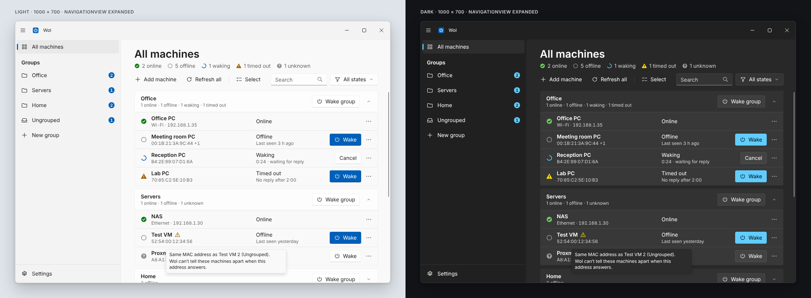
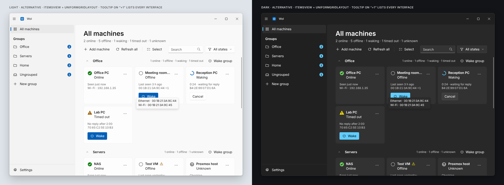
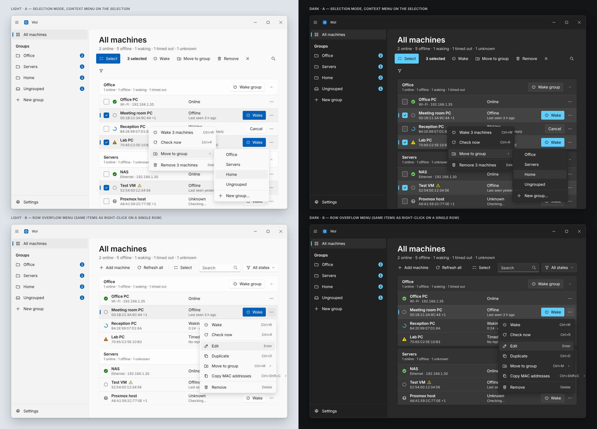
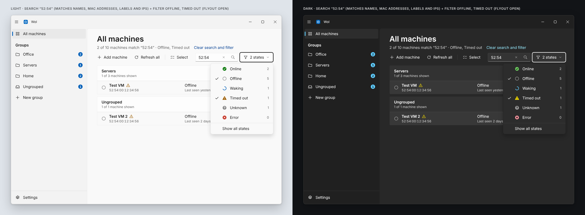
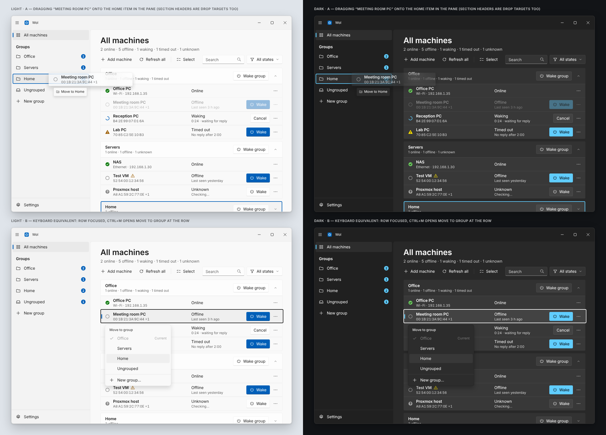
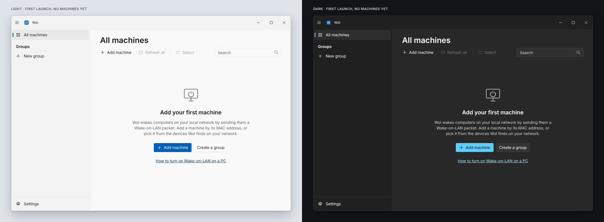
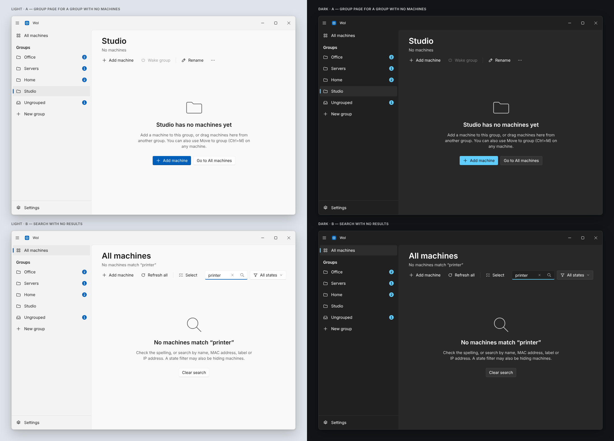

### Groups and editing

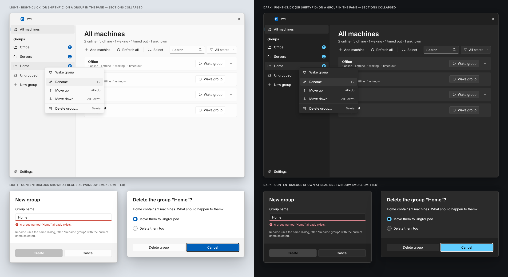
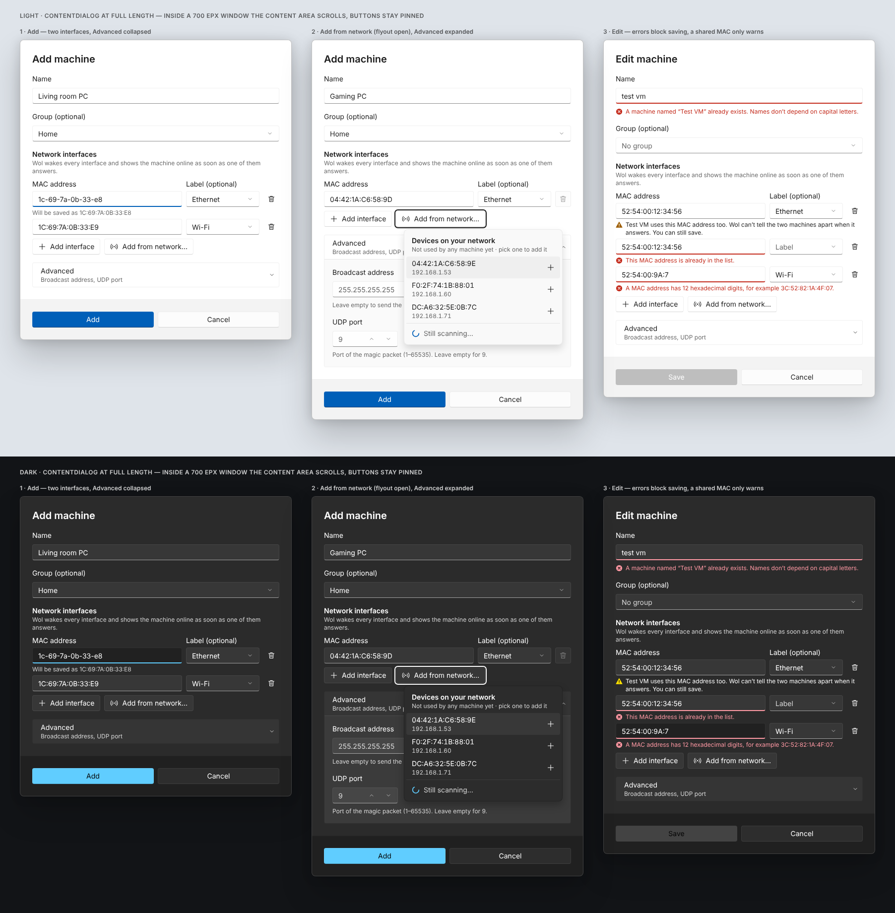

### Wake flow

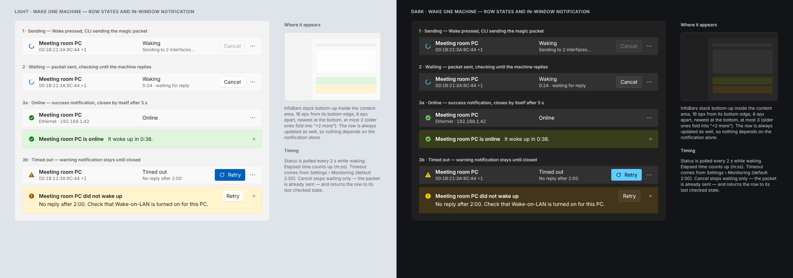
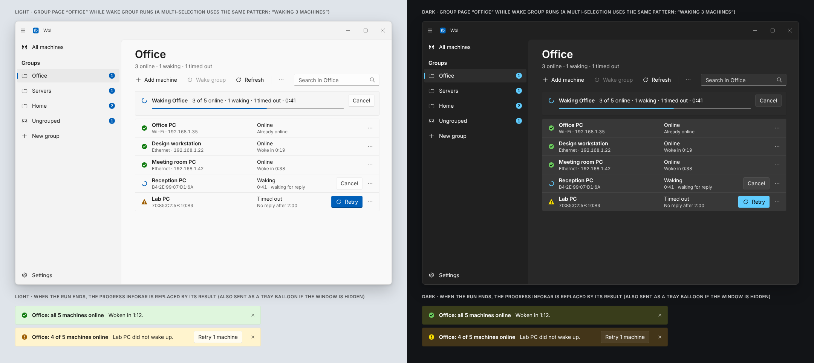

### Settings and notification area

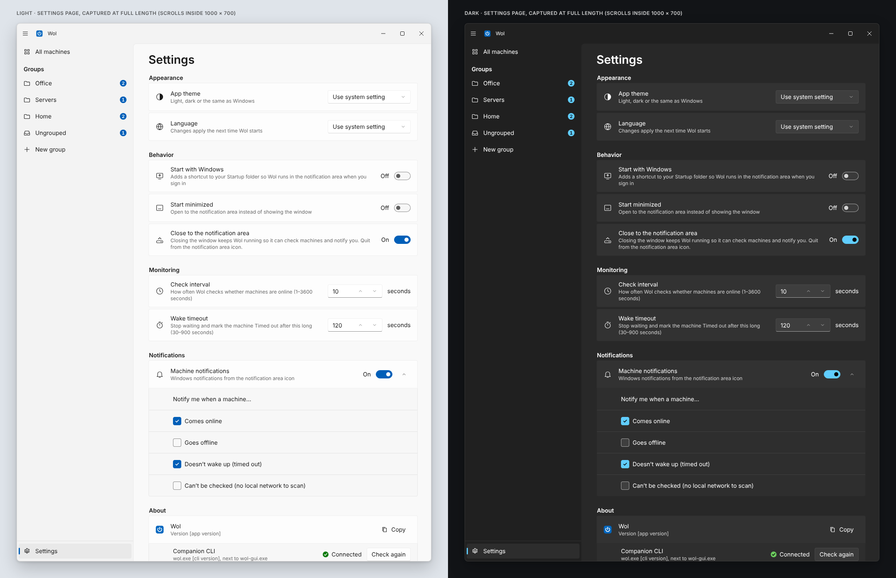
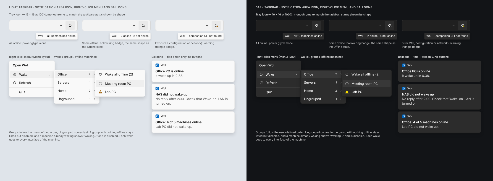

### Errors and window sizes

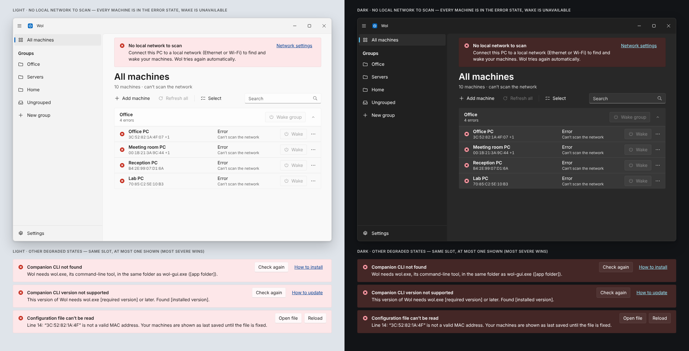
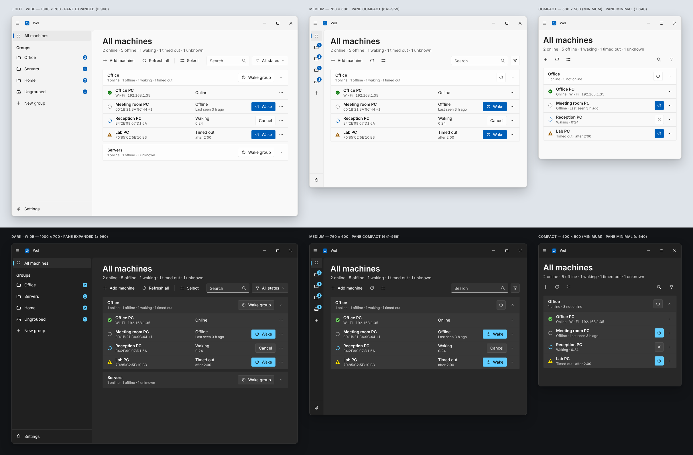

## About the exports

- The PNGs were rendered in Chromium with Selawik, Microsoft’s open-source stand-in for Segoe UI. Open the HTML on Windows to see Segoe UI Variable.
- Icons in the mockups are drawn approximations of the Segoe Fluent Icons glyphs named in the specs.
- Values not known yet are left as placeholders, such as `[app version]` or `[path to the CLI]`.
