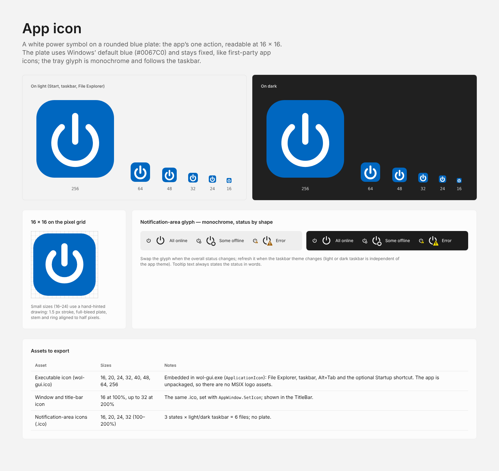

# App icon

A white power symbol on a rounded blue plate: the app’s one action, readable at 16 × 16. The plate uses Windows’ default blue (`#0067C0`) and stays fixed, like first-party app icons. The notification-area glyph is monochrome and follows the taskbar theme.

## Sources

| File | Use |
| --- | --- |
| [`app-icon.svg`](../assets/app-icon.svg) | Master, 256 × 256: plate 224 with radius 52, stroke 18 |
| [`app-icon-16.svg`](../assets/app-icon-16.svg) | Hand-hinted 16 × 16 drawing (1.5 px stroke, full-bleed plate), used for 16–24 px |
| `tray-{online,offline,error}-{light,dark}-taskbar.svg` | Notification-area glyphs, one per status and taskbar theme |

## Optical sizes

The stroke gets relatively heavier as the icon shrinks (units of the 256 grid): 18 at 256, 22 at 64, 24 at 48, 26 at 32, 28 at 24, 30 at 16. Below 32 px, prefer the hand-hinted 16 px drawing.

## Notification-area glyph

| Status | Shape | Tooltip example |
| --- | --- | --- |
| All online | Power glyph alone | Wol — all 10 machines online |
| Some offline | Hollow ring badge, the same shape as the Offline state | Wol — 2 online · 6 not online |
| Error (CLI, configuration or network) | Warning triangle badge: `#9D5D00` on a light taskbar, `#FCE100` on a dark one | Wol — companion CLI not found |

Swap the icon when the overall status changes, and again when the taskbar theme changes — it is independent of the app theme. The tooltip always states the status in words.

## Assets to export

| Asset | Sizes | Notes |
| --- | --- | --- |
| Executable icon (`wol-gui.ico`) | 16, 20, 24, 32, 40, 48, 64, 256 | Embedded in `wol-gui.exe` (`ApplicationIcon`): File Explorer, taskbar, Alt+Tab and the optional Startup shortcut. The app is unpackaged, so there are no MSIX logo assets |
| Window and title-bar icon | 16 at 100%, up to 32 at 200% | The same `.ico`, set with `AppWindow.SetIcon`; shown in the `TitleBar` |
| Notification-area icons (`.ico`) | 16, 20, 24, 32 (100–200%) | 3 states × light/dark taskbar = 6 files, no plate |
