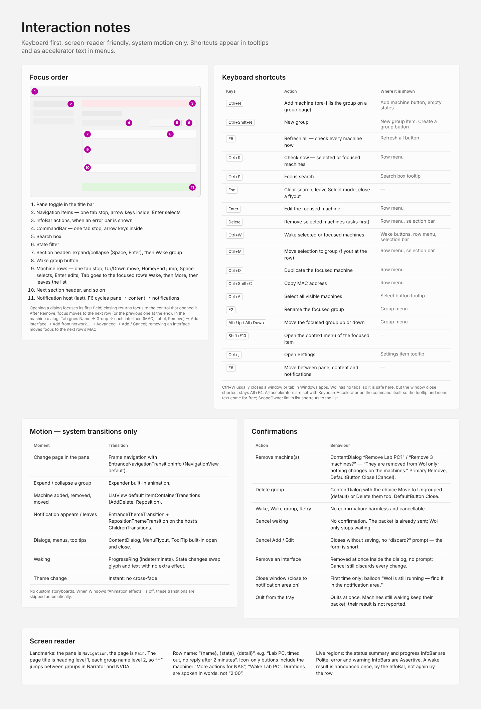

# Interaction notes

Keyboard first, screen-reader friendly, system motion only. Shortcuts appear in tooltips and as accelerator text in menus.

## Focus order

1. Pane toggle in the title bar
2. Navigation items — one tab stop, arrow keys inside, Enter selects
3. InfoBar actions, when an error bar is shown
4. CommandBar — one tab stop, arrow keys inside
5. Search box
6. State filter
7. Section header: expand / collapse (Space, Enter)
8. Wake group button
9. Machine rows — one tab stop; Up/Down move, Home/End jump, Space selects, Enter edits; Tab goes to the focused row’s Wake, then More, then leaves the list
10. Next section header, and so on
11. Notification host (last). F6 cycles pane → content → notifications.

Opening a dialog focuses its first field; closing returns focus to the control that opened it. After Remove, focus moves to the next row (or the previous one at the end).

In the machine dialog, Tab goes Name → Group → each interface (MAC, Label, Remove) → Add interface → Add from network… → Advanced → Add / Cancel; removing an interface moves focus to the next row’s MAC.

## Keyboard shortcuts

| Keys | Action | Where it is shown |
| --- | --- | --- |
| <kbd>Ctrl+N</kbd> | Add machine (pre-fills the group on a group page) | Add machine button, empty states |
| <kbd>Ctrl+Shift+N</kbd> | New group | New group item, Create a group button |
| <kbd>F5</kbd> | Refresh all — check every machine now | Refresh all button |
| <kbd>Ctrl+R</kbd> | Check now — selected or focused machines | Row menu |
| <kbd>Ctrl+F</kbd> | Focus search | Search box tooltip |
| <kbd>Esc</kbd> | Clear search, leave Select mode, close a flyout | — |
| <kbd>Enter</kbd> | Edit the focused machine | Row menu |
| <kbd>Delete</kbd> | Remove selected machines (asks first) | Row menu, selection bar |
| <kbd>Ctrl+W</kbd> | Wake selected or focused machines | Wake buttons, row menu, selection bar |
| <kbd>Ctrl+M</kbd> | Move selection to group (flyout at the row) | Row menu, selection bar |
| <kbd>Ctrl+D</kbd> | Duplicate the focused machine | Row menu |
| <kbd>Ctrl+Shift+C</kbd> | Copy MAC address | Row menu |
| <kbd>Ctrl+A</kbd> | Select all visible machines | Select button tooltip |
| <kbd>F2</kbd> | Rename the focused group | Group menu |
| <kbd>Alt+Up / Alt+Down</kbd> | Move the focused group up or down | Group menu |
| <kbd>Shift+F10</kbd> | Open the context menu of the focused item | — |
| <kbd>Ctrl+,</kbd> | Open Settings | Settings item tooltip |
| <kbd>F6</kbd> | Move between pane, content and notifications | — |

Ctrl+W usually closes a window or tab in Windows apps. Wol has no tabs, so it is safe here, but the window close shortcut stays Alt+F4. All accelerators are set with `KeyboardAccelerator` on the command itself so the tooltip and menu text come for free; `ScopeOwner` limits list shortcuts to the list.

## Motion — system transitions only

| Moment | Transition |
| --- | --- |
| Change page in the pane | Frame navigation with EntranceNavigationTransitionInfo (NavigationView default). |
| Expand / collapse a group | Expander built-in animation. |
| Machine added, removed, moved | ListView default ItemContainerTransitions (AddDelete, Reposition). |
| Notification appears / leaves | EntranceThemeTransition + RepositionThemeTransition on the host’s ChildrenTransitions. |
| Dialogs, menus, tooltips | ContentDialog, MenuFlyout, ToolTip built-in open and close. |
| Waking | ProgressRing (indeterminate). State changes swap glyph and text with no extra effect. |
| Theme change | Instant; no cross-fade. |

No custom storyboards. When Windows “Animation effects” is off, these transitions are skipped automatically.

## Confirmations

| Action | Behaviour |
| --- | --- |
| Remove machine(s) | ContentDialog “Remove Lab PC?” / “Remove 3 machines?” — “They are removed from Wol only; nothing changes on the machines.” Primary Remove, DefaultButton Close (Cancel). |
| Delete group | ContentDialog with the choice Move to Ungrouped (default) or Delete them too. DefaultButton Close. |
| Wake, Wake group, Retry | No confirmation: harmless and cancellable. |
| Cancel waking | No confirmation. The packet is already sent; Wol only stops waiting. |
| Cancel Add / Edit | Closes without saving, no “discard?” prompt — the form is short. |
| Remove an interface | Removed at once inside the dialog, no prompt: Cancel still discards every change. |
| Close window (close to notification area on) | First time only: balloon “Wol is still running — find it in the notification area.” |
| Quit from the tray | Quits at once. Machines still waking keep their packet; their result is not reported. |

## Screen reader

- Landmarks: the pane is `Navigation`, the page is `Main`. The page title is heading level 1, each group name level 2, so “H” jumps between groups in Narrator and NVDA.
- Row name: “{name}, {state}, {detail}”, e.g. “Lab PC, timed out, no reply after 2 minutes”. Icon-only buttons include the machine: “More actions for NAS”, “Wake Lab PC”. Durations are spoken in words, not “2:00”.
- Live regions: the status summary and the progress InfoBar are Polite; error and warning InfoBars are Assertive. A wake result is announced once, by the InfoBar, not again by the row.
