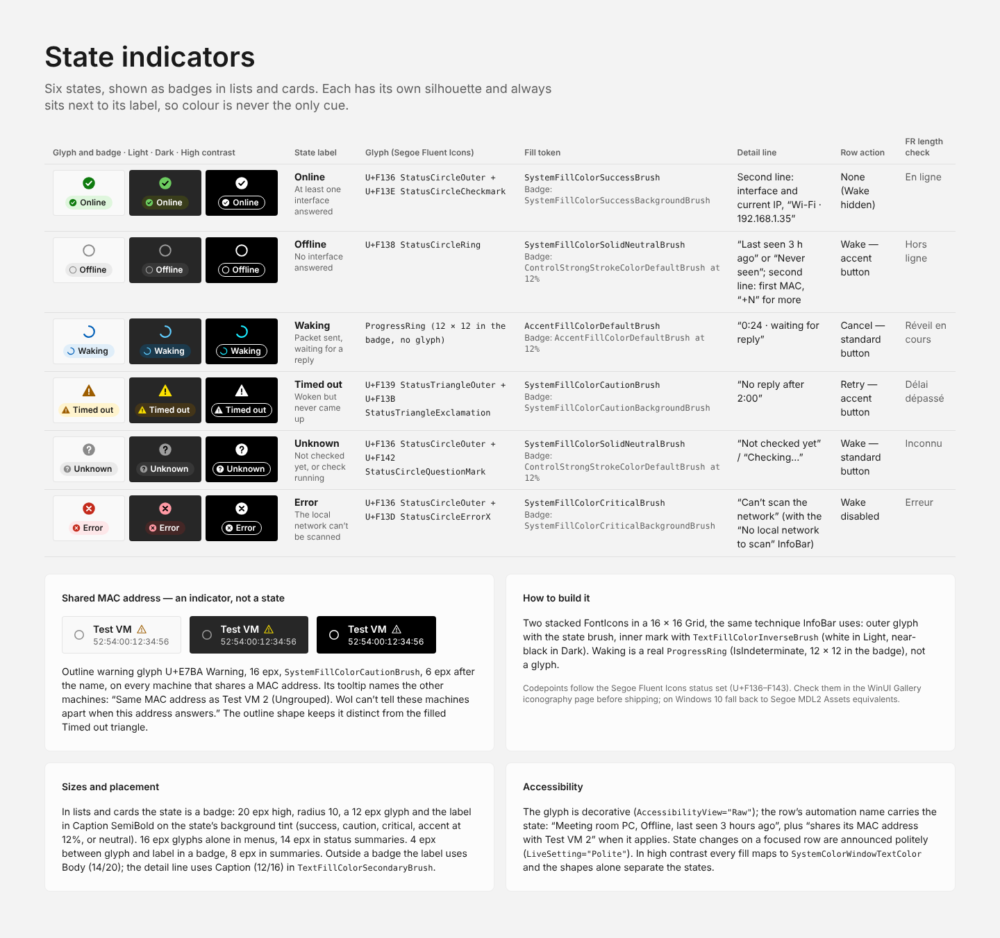

# State indicators

Six states. Each has its own silhouette and always sits next to its label, so colour is never the only cue.

| State | Meaning | Glyph (Segoe Fluent Icons) | Fill token | Detail line | Row action | FR length check |
| --- | --- | --- | --- | --- | --- | --- |
| **Online** | At least one interface answered | U+F136 StatusCircleOuter + U+F13E StatusCircleCheckmark | `SystemFillColorSuccessBrush` | Second line: interface and current IP, “Wi-Fi · 192.168.1.35” | None (Wake hidden) | En ligne |
| **Offline** | No interface answered | U+F138 StatusCircleRing | `SystemFillColorSolidNeutralBrush` | “Last seen 3 h ago” or “Never seen”; second line: first MAC, “+N” for more | Wake — accent button | Hors ligne |
| **Waking** | Packet sent, waiting for a reply | ProgressRing (12 × 12 in the badge, no glyph) | `AccentFillColorDefaultBrush` | “0:24 · waiting for reply” | Cancel — standard button | Réveil en cours |
| **Timed out** | Woken but never came up | U+F139 StatusTriangleOuter + U+F13B StatusTriangleExclamation | `SystemFillColorCautionBrush` | “No reply after 2:00” | Retry — accent button | Délai dépassé |
| **Unknown** | Not checked yet, or check running | U+F136 StatusCircleOuter + U+F142 StatusCircleQuestionMark | `SystemFillColorSolidNeutralBrush` | “Not checked yet” / “Checking…” | Wake — standard button | Inconnu |
| **Error** | The local network can’t be scanned | U+F136 StatusCircleOuter + U+F13D StatusCircleErrorX | `SystemFillColorCriticalBrush` | “Can’t scan the network” (with the “No local network to scan” InfoBar) | Wake disabled | Erreur |

## Shared MAC address — an indicator, not a state

Several machines may use the same MAC address (cloned virtual machines, for example). Each of them shows an outline warning glyph (U+E7BA Warning, 16 epx, `SystemFillColorCautionBrush`) 6 epx after its name. Its tooltip names the other machines: “Same MAC address as Test VM 2 (Ungrouped). Wol can’t tell these machines apart when this address answers.” The outline shape keeps it distinct from the filled Timed out triangle.

## How to build it

Two stacked `FontIcon`s in a 16 × 16 `Grid`, the same technique `InfoBar` uses: outer glyph with the state brush, inner mark with `TextFillColorInverseBrush` (white in Light, near-black in Dark). Waking is a real `ProgressRing` (`IsIndeterminate`, 16 × 16), not a glyph.

Codepoints follow the Segoe Fluent Icons status set (U+F136–F143). Check them in the WinUI Gallery iconography page before shipping; on Windows 10 fall back to Segoe MDL2 Assets equivalents.

## Sizes and placement

16 epx in list rows and menus, 14 epx in status summaries, 20 epx in cards. 8 epx between glyph and text in summaries, 12 epx column gap in rows. The label uses Body (14/20); the detail line uses Caption (12/16) in `TextFillColorSecondaryBrush`.

## Accessibility

The glyph is decorative (`AccessibilityView="Raw"`); the row’s automation name carries the state: “Meeting room PC, Offline, last seen 3 hours ago”, plus “shares its MAC address with Test VM 2” when it applies. State changes on a focused row are announced politely (`LiveSetting="Polite"`). In high contrast every fill maps to `SystemColorWindowTextColor` and the shapes alone separate the states.
